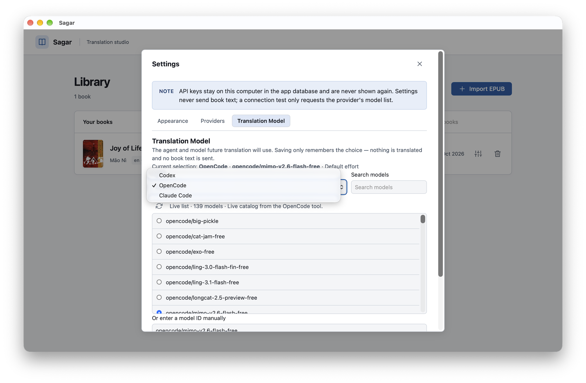
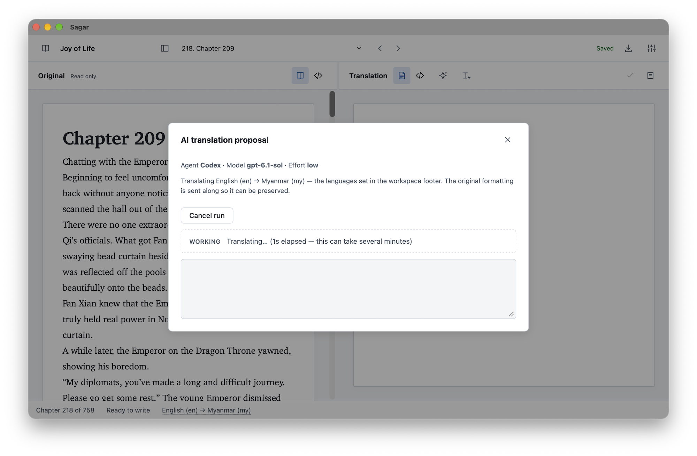
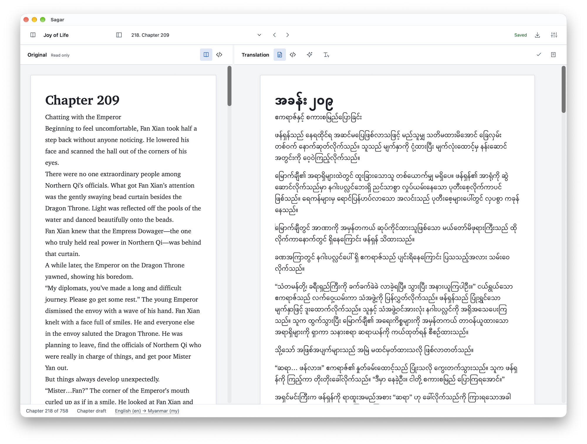
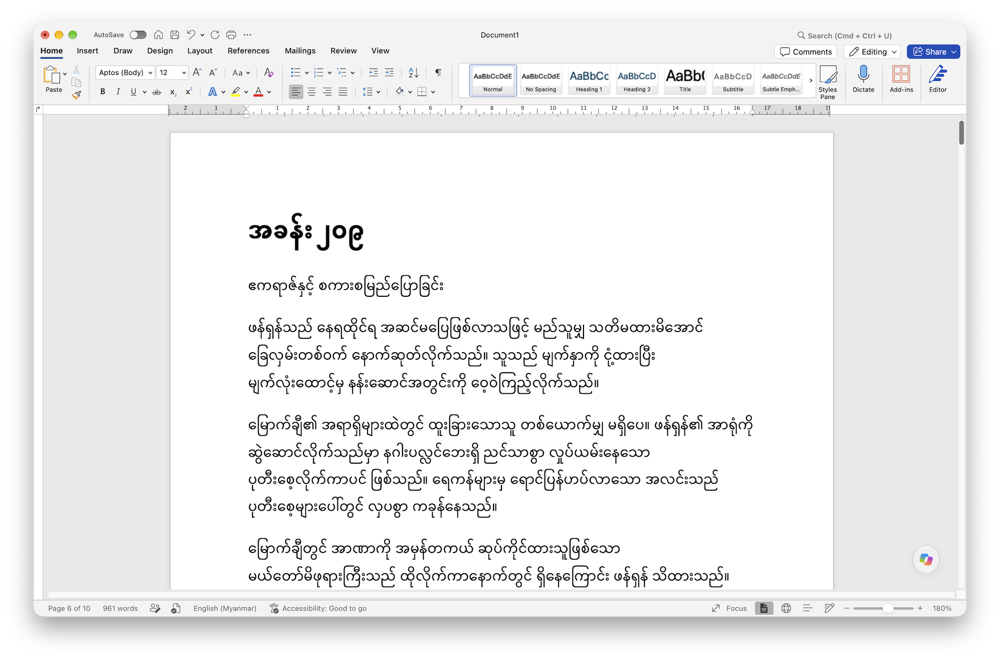

# Sagar — EPUB Translation Studio
An offline-first desktop app for manually translating DRM-free EPUB books,
side by side, without losing the original formatting. Read the original
chapter on the left, write the translation on the right, review chapters, and export a separate translated EPUB.


Built with Tauri 2, React, TypeScript and Rust; SQLite stores project data
locally. **No** **account,** **no** **network:** **book** **content** **never** **leaves** **the** **machine.**

## Development (Bun + Rust)

```bash
bun install
bun tauri dev        # run the desktop app in development mode
bun run check        # Biome lint + TypeScript + frontend build
cd src-tauri
cargo fmt --check && cargo test
cargo clippy --all-targets -- -D warnings
```

Requires the **Tauri** **2** **prerequisites** for your OS (see
[https://v2.tauri.app/start/prerequisites/](https://v2.tauri.app/start/prerequisites/) ).

## How it works

1. **Import** — open a DRM-free, reflowable EPUB 3 file. The app validates the
archive safely, reads metadata/manifest/spine/navigation, copies an
immutable snapshot into app-owned storage, and detects translatable blocks
(headings, paragraphs, list items, captions).
1. **Translate** — chapters are listed in reading order. Each chapter shows
the original (read-only) next to an editable translation. Chapter documents autosave
with revision protection; you can mark chapters **reviewed** or choose
**keep** **original**. Text structures the editor cannot translate safely
(tables, preformatted text, MathML…) are preserved unchanged and listed as
import notes.
1. **Export** — a review dialog shows exactly what is translated. A
completed export requires every chapter reviewed or intentionally
kept original; a draft export keeps untranslated chapters in the original
language after explicit acknowledgement. The exported book is a new file:
translated fragments are spliced into a copy of the original XHTML, so
images, links, footnotes and structure are preserved, and the output is
re-validated before the app reports success.

## Where your data lives

- Database and immutable book snapshots: `~/Library/Application Support/app.myanmars.sagar`
(macOS; equivalent app-data directories on Windows/Linux).
- Delete that folder to reset the library (this also deletes translations).
- The original EPUB file you open is never modified.
- Presentation preferences (theme, text size, pane widths) live in the
WebView's local storage, separate from translations.

## Translate using AI
Use your own subscription instead of using Token.
Sagar is supporting 
- Codex
- Claude Code
- Open Code




It allow to copy and paste in your MS Word , too.

